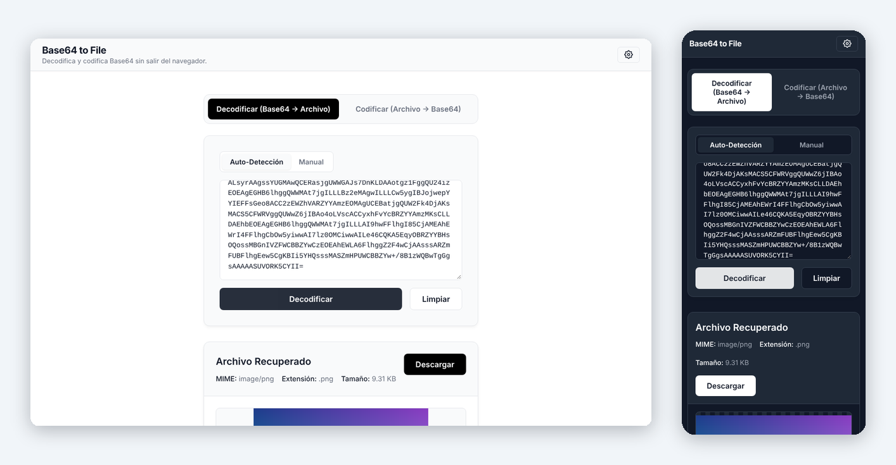

# Base64 to File Converter 📁

*Leer esto en [Español](README-es.md).*

A fast, local-first web tool designed for developers and technical users. It decodes Base64 text strings (including Data URIs) and retrieves the original files instantly.

All processing is done locally in your web browser, ensuring **complete control** of your data (Local-First). Built with **Vue 3 (Composition API)** and **TypeScript**.

**▶ [Try it: base64-to-file.jnfire.dev](https://base64-to-file.jnfire.dev/)**



## ✨ Key Features
- **Dual Detection:**
  - **Automatic:** Identifies file types via Data URIs or by parsing binary *Magic Bytes* (PNG, JPEG, PDF, ZIP, GIF, XML).
  - **Manual:** Forces a file type using a selector with common formats (Word, Excel, JSON, SVG, etc.).
- **Smart Preview:**
  - **Images & SVGs:** Displayed natively in the browser.
  - **PDFs:** Embedded for quick review without downloading.
  - **Data (JSON/XML/Text):** Embedded code viewer with **auto-formatting for JSON** for easy reading.
- **Local Processing:** Everything happens client-side. Your files and converted data are never sent to any server.
- **No Tracking:** No cookies, no analytics and no sign-up.
- **Interface:** Clean, responsive design with dark/light mode support. Multi-language support.

## 🛠️ Built With
- **Vue.js 3** (Composition API) + **Vite**
- **TypeScript** for robust, typed code.
- **Vue-i18n** for multi-language support.
- **Vanilla CSS** for optimal performance without external dependencies.

## 📁 Project Architecture
The project follows a modular architecture separating business logic from the view layer. You can check the details in [`docs/ARCHITECTURE.md`](docs/ARCHITECTURE.md).

## 🚀 How to Run Locally
```sh
npm install
npm run dev
```

## 📚 Documentation

- [Architecture](docs/ARCHITECTURE.md)
- [Design system](docs/DESIGN-SYSTEM.md), shared with the other portfolio tools
- [Roadmap](docs/ROADMAP.md)
- [Evolution](docs/evolution/README.md): how the project has changed, with screenshots

## 🤝 Development

Designed and directed by [Javier Nicolás Pérez Mesa](https://github.com/jnfire): the product, the architecture and the design decisions are the author's. AI has been part of the work as a deliberate experiment in learning new technology: Gemini CLI, Antigravity, GitHub Copilot and Claude Code, tried one after another. It began with small interventions and, as the experiment went on, moved towards more autonomy, always through pull requests that the author reviews. Commits made with Claude Code carry a `Co-Authored-By` trailer.

## 📄 License
Copyright (C) 2026 Javier Nicolás Pérez Mesa.

This project is free software released under the [GNU Affero General Public License v3.0](LICENSE) (`AGPL-3.0-only`). You may use, study, modify and share it. If you distribute a modified version, or offer it to users over a network, you must make its source code available under the same license.

---
Made by [Javier Nicolás Pérez Mesa](https://github.com/jnfire), 2026.
