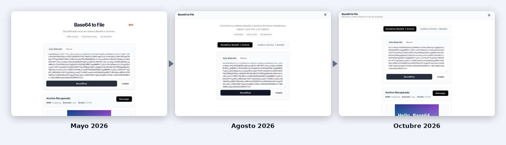

# Evolution

*Read this in [Spanish](README-es.md).*

How Base64 to File went from its first commit to today, with the screenshots to show it.

## The story

Base64 to File did not so much change its look as its shape. It started as a decoder with a big title and badges. Every real need that appeared added a piece, and each piece became a component or a pattern: tabs once there were two directions, a shared preview component for images, PDF and text, a settings card for the theme and the encoder options, an accessible language selector. Along the way the interface got simpler: the hero block went away and the footer states the facts.

Releases: v0.1.0 and v0.2.0 (May 2026) stay as they were; this work continues them as 1.0.0.

## Timeline

| When | What happened |
| --- | --- |
| April 2026 | First commit. |
| May 2026 | First release (v0.1.0): the decoder, with its own large title, language flag and badges. A week later (v0.2.0) the encoder arrived, with tabs and a layout for phones. |
| July–August 2026 | Accessible language selector with flags, sticky header with the version in the footer, unified settings (theme and encoder options), ARIA roles and keyboard support, a shared preview component and more tests. |
| October 2026 | Free software (AGPL-3.0), no Google Analytics or cookie banner, one design system shared with the other two tools, CI that gates every deploy, and version 1.0.0, the next step after 0.1.0 and 0.2.0. |

## In numbers

| | Before (August 2026) | Now |
| --- | --- | --- |
| Automated tests | 29 | 46 |
| License | All rights reserved | AGPL-3.0 |
| Analytics | Google Analytics and a cookie banner | None |
| Deploy | Only if the tests pass | Only if lint, format, shared components, tests and build pass |
| Dependency advisories (npm audit) | High severity (vue-i18n) | None |

The "before" column is the state of the project on 28 August 2026, just before the round of work described above.

## Images

All the images are in this folder and in [`../screenshots`](../screenshots); they use sample data.

- [`base64-to-file-evolution-desktop.png`](base64-to-file-evolution-desktop.png): Three stages side by side, desktop
- [`base64-to-file-evolution-mobile.png`](base64-to-file-evolution-mobile.png): The same three stages on a phone

## How it was built

Designed and directed by [Javier Nicolás Pérez Mesa](https://github.com/jnfire): the product, the architecture and the design decisions are the author's. AI has been part of the work as a deliberate experiment in learning new technology: Gemini CLI, Antigravity, GitHub Copilot and Claude Code, tried one after another. It began with small interventions and, as the experiment went on, moved towards more autonomy, always through pull requests that the author reviews. Commits made with Claude Code carry a `Co-Authored-By` trailer.
